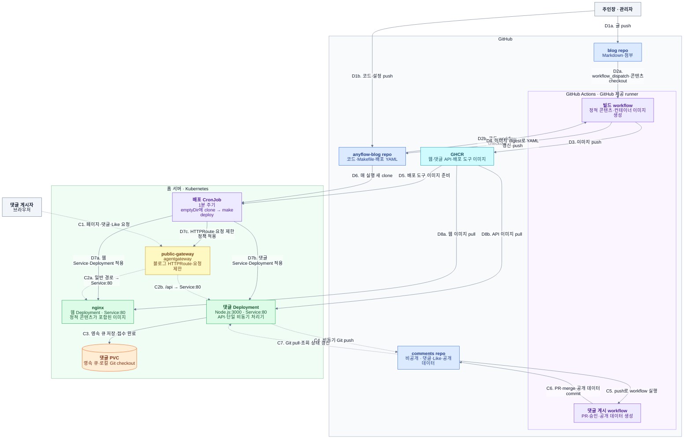

# Architecture

## Introduction

정적 콘텐츠 생성, 댓글 데이터 처리, 배포를 각각 독립된 흐름으로 구성한다. 사이트 코드는 이 저장소, 작성 원본과 댓글 원본은 별도 Git 저장소에서 관리한다.

## Summary

GitHub 제공 runner에서 산출물을 생성하고, Kubernetes는 완성된 이미지와 배포 선언을 가져와 실행한다. 다음 그림은 애플리케이션 단위의 논리 배포 뷰다.

| 컴포넌트 | 역할 |
| --- | --- |
| 주인장 · 관리자 | 글·코드·설정을 작성하고 push하며 댓글 승인·관리를 수행한다. |
| 댓글 게시자 | 브라우저에서 페이지를 조회하고 댓글·답글·Like와 본인 댓글 수정·삭제를 요청한다. |
| blog repo | 작성 Markdown과 첨부를 보관하고 콘텐츠 변경 시 빌드 workflow를 호출한다. |
| anyflow-blog repo | 코드·템플릿·Makefile·workflow와 이미지 digest가 기록된 배포 YAML을 보관한다. |
| comments repo | 댓글·Like·작성 권한 데이터와 댓글 게시 workflow를 비공개로 보관한다. |
| 빌드 workflow | GitHub 제공 runner에서 입력을 검증하고 정적 콘텐츠·이미지를 생성해 GHCR과 배포 YAML에 게시한다. |
| 댓글 게시 workflow | GitHub 제공 runner에서 신규 댓글 PR·승인 절차와 공개 데이터 생성을 수행한다. |
| GHCR | 웹·댓글 API·배포 도구 이미지를 digest별로 보관한다. |
| 배포 CronJob | 매분 emptyDir에 코드를 clone하고 make deploy로 Service·Deployment·라우팅·정책을 적용한다. |
| public-gateway | HTTPS를 수신하고 HTTPRoute로 정적 콘텐츠와 API를 분기하며 요청 제한을 적용한다. |
| nginx | 이미지에 포함된 HTML·CSS·JS·미디어·검색 색인을 제공하고 정규 URL 리다이렉트를 처리한다. |
| 댓글 Deployment | 입력·인증·권한 검증, 로컬 상태 조회, 영속 큐 접수와 단일 비동기 처리기의 Git 저장을 수행한다. |
| 댓글 PVC | API 재시작에도 필요한 작업 큐·처리 기록·댓글 Git checkout을 보존한다. |

D는 배포, C는 페이지 조회·댓글 처리 순서이며 a/b/c는 같은 단계의 분기다. 리소스 적용과 이미지 다운로드는 일부 병렬로 진행한다. C3의 영속 저장을 마친 뒤 접수를 응답한다. C6의 PR 절차는 신규 댓글·답글에 적용하며 Like·기존 공개 댓글 수정·삭제는 main에 직접 저장한다.

waypoint·ztunnel·응답 경로·Secret 등 세부 인프라는 그림에서 생략한다. 현재 실제 웹/API 연결은 메시 설정에 따라 Istio waypoint를 경유하며, HTTPRoute에는 각 Service만 지정한다.

## 기술 선택 이유

각 기술은 정적 블로그와 낮은 요청량의 댓글을 운영하는 데 필요한 실행 환경과 관리 대상을 줄이기 위해 선택한다.

| 기술 | 선택 이유 |
| --- | --- |
| Eleventy·Nunjucks | 데이터와 템플릿으로 페이지 구조를 제어하고 HTML을 빌드하므로 서버 측 페이지 실행 환경을 운영하지 않는다. |
| Pagefind | 생성 HTML로 색인을 만들고 브라우저에서 검색하므로 별도 검색 서버·DB를 운영하지 않는다. |
| Markdown-it·KaTeX·Mermaid | Markdown 원본에 표현을 보존하면서 수식은 빌드 시, 다이어그램은 브라우저에서 테마에 맞게 처리한다. |
| nginx | 정적 산출물과 HTTP 제공 설정을 같은 이미지로 고정해 교체·복구 단위를 일치시킨다. |
| agentgateway | 공통 Gateway와 블로그 소유 HTTPRoute·정책의 설정 책임을 분리한다. |
| GitHub Actions·GHCR | 홈 서버의 빌드 부하를 줄이고 코드·콘텐츠 조합의 산출물을 이미지 digest로 배포한다. |
| Kubernetes CronJob·Makefile | 배포 수신 API·상시 배포 서버 없이 Kubernetes와 make 명령으로 주기적 적용을 수행한다. |
| Node.js·Git·PVC | 낮은 요청량에서 별도 SQL·Redis를 운영하지 않고 영속 접수와 Git 변경 이력을 확보한다. |

## 빌드와 배포 보장

D 단계는 검증을 통과한 산출물을 게시하고, 배포 실패는 다음 정기 실행에서 재시도한다.

- 게시 속성·Markdown·내부 링크·참조 첨부를 검증한다. 작성 규칙과 공개 범위는 [CONTENT_CONTRACT.md](CONTENT_CONTRACT.md)를 따른다.
- 링크 메타데이터·X 사진·Mermaid 등의 카드/OG 이미지는 수집 결과를 캐시해 재사용한다.
- HTML·검색 색인·sitemap·공개 글 카탈로그를 임시 경로에서 완성한 뒤 `_site` 또는 `_preview`를 교체한다. 직전 결과는 `.cache/previous-build`에 한 개 보관한다.
- 빌드 중 코드 또는 콘텐츠 SHA가 바뀌면 오래된 배포 선언의 게시를 생략한다.

CronJob은 `concurrencyPolicy: Forbid`로 정기 작업의 중복 실행을 막는다. 매 실행마다 master 브랜치를 depth 1로 clone하고 작업 종료 시 checkout을 정리한다. emptyDir은 Pod와 함께 제거하며 배포 PVC·파일 잠금·마지막 성공 기록은 사용하지 않는다. 동일한 이미지 digest의 YAML을 재적용해도 웹/API Pod는 교체하지 않는다.

웹·댓글 API·배포 도구 이미지는 독립된 digest를 사용하므로 사이트 변경만 배포할 때 댓글 API를 교체하지 않는다. 이미지 선언과 적용 명령은 [Makefile](Makefile), [배포 스크립트](scripts/poll-deploy.sh), [빌드 workflow](.github/workflows/publish.yml)를 따른다.

## 댓글·Like 처리

방문자의 요청은 PVC에 저장한 뒤 접수를 응답하고 Git 저장은 같은 API 프로세스의 비동기 처리기가 순서대로 수행한다.

- 브라우저는 작성·수정·삭제·Like 상태를 먼저 표시하고 접수·실패 상태를 안내한다. 실패한 초안과 재시도 식별자를 유지한다.
- API는 입력·글 카탈로그·Origin·쿠키 권한을 검증한다. 이름·이메일·홈페이지 자체는 작성 권한 증명이 아니다.
- `request_id`로 재접수를 구분하고 Like의 `client_id`·`sequence`로 연속 요청의 순서를 보존한다. 댓글 수정·삭제는 버전 충돌을 검사한다.
- 큐는 대기 100건·직렬화된 대기 요청 1MiB로 제한한다. 신규 초과 요청은 저장 전에 `503 queue_full`과 `Retry-After: 5`로 거절한다.
- 완료 기록과 비활성 Like 순서 키는 최대 7일·2,000개로 정리한다. 대기·재시도 작업과 작업이 사용하는 키는 보존한다.
- 조회는 로컬 상태와 접수한 변경을 반영한다. 백그라운드 Git 동기화로 외부 변경을 가져오며 읽기 요청마다 Git fetch를 기다리지 않는다.
- API는 PVC 한 개와 `replicas: 1`, `Recreate` 전략을 사용한다. 이 구조는 여러 writer Pod를 위한 분산 큐가 아니다.

신규 댓글·답글은 비공개 댓글 저장소의 `incoming/**` 브랜치와 PR을 거친다. 승인 기본값은 OFF이며 해당 댓글 Actions가 자동 게시한다. 승인을 켜면 관리자의 승인 절차를 따른다. Like·기존 공개 댓글 수정·삭제는 신규 댓글 PR 알림을 만들지 않는다.

댓글 저장소에 적용할 workflow와 게시 코드는 [integrations/comments-data/](integrations/comments-data/)에 있다. 이 코드와 `lib/comments/`의 관련 모듈을 함께 배포하고 실제 댓글 데이터는 보존한다. GitHub PR 알림으로 새 댓글을 인지한다.

## 인증과 공개 경계

서명 키·관리자 키·Git SSH 키는 실행 환경의 비공개 설정과 Kubernetes Secret으로 제공한다.

| 기능 | 권한 |
| --- | --- |
| 게시된 댓글 조회 | 익명 허용 |
| 댓글·답글·Like | 방문자 쿠키, 허용 Origin, 입력 검증 |
| 본인 댓글 수정·삭제 | 작성한 브라우저의 쿠키 |
| 전체 댓글 관리·승인 설정 | 관리자 인증 쿠키 |

방문자 쿠키는 1년, 관리자 쿠키는 7일을 사용한다. 쿠키를 잃으면 해당 브라우저의 작성 권한과 Like 식별도 잃는다. 관리자는 별도 브라우저에서도 인증 후 관리할 수 있다. 댓글 본문은 텍스트로 표시하고 HTTP/HTTPS/www 주소만 안전한 DOM 링크로 만든다.

Gateway의 로컬 요청 제한은 로그인·쓰기·조회에 접속 주소별 한도와 전체 한도를 함께 적용한다. 정책 값은 [agentgatewaypolicy.yaml](deployment/agentgatewaypolicy.yaml)을 따른다. 카운터는 프록시마다 독립적이며 재시작 시 초기화된다. NAT나 중간 프록시로 출발지 주소가 합쳐지면 사용자들이 주소 한도를 공유한다. 클라이언트가 제공한 `X-Forwarded-For`를 식별 키로 신뢰하지 않는다.

일반 방문자에게는 게시된 댓글·표시 작성자·Like 집계를 제공한다. 작성자와 관리자는 권한에 따라 대기 댓글과 작업 상태를 조회할 수 있다. 작성 권한 해시·요청 fingerprint·비공개 원본 설정은 공개 응답에 포함하지 않는다. `noindex`는 공개 접근 제어 수단이 아니다.
