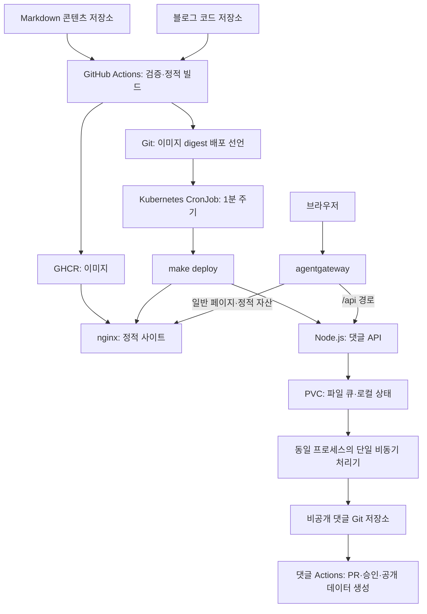

# Architecture

## Introduction

정적 콘텐츠 생성, 댓글 데이터 처리, 배포를 각각 독립된 흐름으로 구성한다. 사이트 코드는 이 저장소, 작성 원본과 댓글 원본은 별도 Git 저장소에서 관리한다.

## Summary

GitHub 제공 runner에서 산출물을 생성하고, Kubernetes는 완성된 이미지와 배포 선언을 가져와 실행한다.

## 구성과 선택 이유

블로그의 정적 읽기 경로와 변경 요청 경로에 필요한 구성 요소를 배치한다.

| 구성 | 역할과 선택 이유 |
| --- | --- |
| Eleventy·Nunjucks | Markdown 데이터와 템플릿을 HTML로 생성한다. 서버 측 페이지 실행 환경을 운영하지 않고 페이지 구조를 제어한다. |
| Pagefind | 생성 HTML에서 검색 색인을 만들고 브라우저에서 조회한다. 검색을 위해 별도 서버·DB를 운영하지 않는다. |
| Markdown-it·KaTeX·Mermaid | Markdown·수식·다이어그램을 처리한다. 본문 Mermaid는 브라우저에서 테마에 맞게 렌더링하고 카드/OG 이미지는 빌드에서 생성한다. |
| nginx | 정적 파일·캐시·정규 URL 리다이렉트를 담당한다. |
| agentgateway | 블로그 HTTPRoute에서 `/api`는 댓글 Service:80, 그 외 경로는 웹 Service:80으로 전달하고 API 요청 제한을 적용한다. 댓글 Service의 targetPort는 3000이다. |
| GitHub Actions·GHCR | 홈 서버 밖에서 정적 빌드·이미지 생성과 버전별 이미지 게시를 수행한다. |
| Kubernetes CronJob·Makefile | Git 배포 선언을 주기적으로 가져와 적용한다. 배포 수신 API와 전용 상시 배포 서버를 두지 않는다. |
| Node.js·Git·PVC | 낮은 요청량의 댓글과 Like를 영속 큐·Git 이력으로 관리한다. 별도 SQL·Redis를 운영하지 않는다. |

## 콘텐츠 빌드와 게시

빌드는 입력을 검증하고 완성된 산출물만 게시한다.

1. 콘텐츠 저장소에서 `publish: true` 글과 참조 자산을 읽는다.
2. Markdown·내부 링크·미디어·게시 속성을 해석하고 링크와 첨부를 검증한다.
3. 링크 메타데이터·X 사진·Mermaid 등의 카드/OG 이미지를 수집하거나 캐시에서 재사용한다.
4. Eleventy로 홈·본문·sitemap·robots·공개 댓글 카탈로그를 생성하고 Pagefind 색인을 만든다.
5. 임시 경로의 생성이 성공하면 `_site` 또는 `_preview`를 교체한다. 직전 결과는 `.cache/previous-build`에 한 개 보관한다.
6. Actions가 정적 사이트 이미지를 게시하고 `deployment/deployments.yaml`의 이미지 digest를 커밋한다.

정적 이미지에는 생성된 HTML·JS·CSS·검색 색인·참조 자산이 들어간다. Markdown 원문·Obsidian 설정·Git 이력·비공개 메타데이터는 공개 출력으로 복사하지 않는다. 코드와 콘텐츠 SHA가 빌드 중 바뀌면 오래된 배포 선언 게시를 생략한다.

CronJob은 `concurrencyPolicy: Forbid`로 정기 배포 작업의 중복 실행을 막는다. 매 실행마다 Pod의 `emptyDir`에 지정한 코드 저장소의 master 브랜치를 depth 1로 clone하고 `make deploy`를 실행한다. checkout은 작업 종료 시 정리하고 볼륨은 Pod와 함께 제거된다. 배포 PVC·파일 잠금·마지막 성공 기록은 사용하지 않는다. 동일한 이미지 digest의 YAML을 다시 적용해도 웹/API Pod는 교체하지 않는다. 실패한 작업은 다음 정기 실행에서 새 checkout으로 재시도한다.

정적 이미지·댓글 API 이미지·배포 도구 이미지는 독립된 digest를 사용한다. 사이트 변경만 배포할 때 댓글 API를 교체하지 않는다. 이미지 선언과 적용 명령은 [Makefile](Makefile), [배포 스크립트](scripts/poll-deploy.sh), [workflow](.github/workflows/publish.yml)를 따른다.

## 댓글·Like 처리

방문자의 요청은 PVC에 저장한 뒤 접수를 응답하고 Git 저장은 같은 API 프로세스의 비동기 처리기가 순서대로 수행한다.

- 브라우저는 작성·수정·삭제·Like 상태를 먼저 표시하고 접수·실패 상태를 안내한다. 실패한 초안과 재시도 식별자를 유지한다.
- API는 입력·글 카탈로그·Origin·쿠키 권한을 검증한다. 이름·이메일·홈페이지 자체는 작성 권한 증명이 아니다.
- `request_id`로 재접수를 구분하고 Like의 `client_id`·`sequence`로 연속 요청의 순서를 보존한다. 댓글 수정·삭제는 버전 충돌을 검사한다.
- 큐는 대기 100건·직렬화된 대기 요청 1MiB로 제한한다. 신규 초과 요청은 저장 전에 `503 queue_full`과 `Retry-After: 5`로 거절한다.
- 완료 기록과 비활성 Like 순서 키는 최대 7일·2,000개로 정리한다. 대기·재시도 작업과 작업이 사용하는 키는 보존한다.
- 조회는 로컬 상태와 접수한 변경을 반영한다. 백그라운드 Git 동기화로 외부 변경을 가져오며 읽기 요청마다 Git fetch를 기다리지 않는다.
- API는 PVC 한 개와 `replicas: 1`, `Recreate` 전략을 사용한다. 이 구조는 여러 writer Pod를 위한 분산 큐가 아니다.

신규 댓글·답글은 비공개 댓글 저장소의 `incoming/**` 브랜치와 PR을 거친다. 승인 기본값은 OFF이며 해당 댓글 Actions가 자동 게시한다. 승인을 켜면 관리자의 승인 절차를 따른다. Like·기존 공개 댓글 수정·삭제는 신규 댓글 PR 알림을 만들지 않는다.

댓글 저장소에 적용할 workflow와 게시 코드는 [integrations/comments-data/](integrations/comments-data/)에 있다. 이 코드와 `lib/comments/`의 관련 모듈을 함께 배포하고 실제 댓글 데이터는 보존한다. GitHub PR 알림으로 새 댓글을 인지한다.

## 인증과 공개 경계

서명 키·관리자 키·Git SSH 키는 실행 환경의 비공개 설정과 Kubernetes Secret으로 제공한다.

| 기능 | 권한 |
| --- | --- |
| 게시된 댓글 조회 | 익명 허용 |
| 댓글·답글·Like | 방문자 쿠키, 허용 Origin, 입력 검증 |
| 본인 댓글 수정·삭제 | 작성한 브라우저의 쿠키 |
| 전체 댓글 관리·승인 설정 | 관리자 인증 쿠키 |

방문자 쿠키는 1년, 관리자 쿠키는 7일을 사용한다. 쿠키를 잃으면 해당 브라우저의 작성 권한과 Like 식별도 잃는다. 관리자는 별도 브라우저에서도 인증 후 관리할 수 있다. 댓글 본문은 텍스트로 표시하고 HTTP/HTTPS/www 주소만 안전한 DOM 링크로 만든다.

Gateway의 로컬 요청 제한은 로그인·쓰기·조회에 접속 주소별 한도와 전체 한도를 함께 적용한다. 정책 값은 [agentgatewaypolicy.yaml](deployment/agentgatewaypolicy.yaml)을 따른다. 카운터는 프록시마다 독립적이며 재시작 시 초기화된다. NAT나 중간 프록시로 출발지 주소가 합쳐지면 사용자들이 주소 한도를 공유한다. 클라이언트가 제공한 `X-Forwarded-For`를 식별 키로 신뢰하지 않는다.

일반 방문자에게는 게시된 댓글·표시 작성자·Like 집계를 제공한다. 작성자와 관리자는 권한에 따라 대기 댓글과 작업 상태를 조회할 수 있다. 작성 권한 해시·요청 fingerprint·비공개 원본 설정은 공개 응답에 포함하지 않는다. `noindex`는 공개 접근 제어 수단이 아니다.
