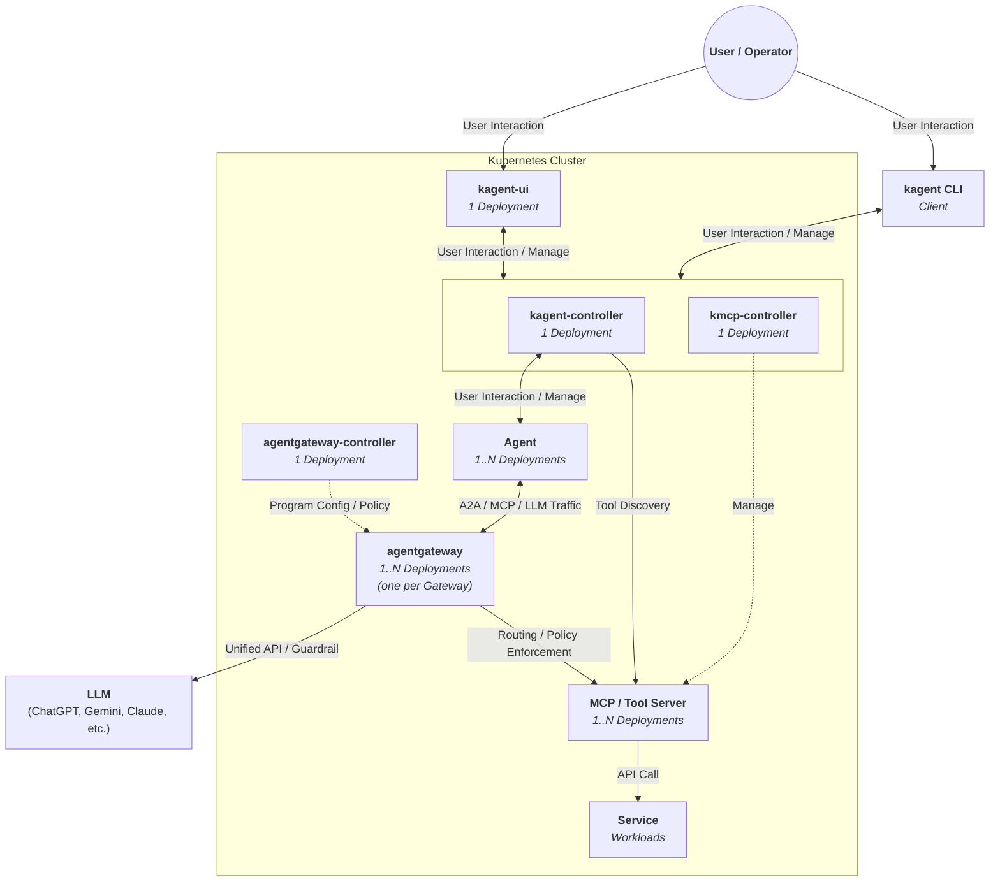

## Introduction

엔터프라이즈 환경에서의 AI Agent 운영은 다음의 요구사항을 만족해야 합니다:

- **접근성:** 내부 서비스, Kubernetes 리소스 등의 엔터프라이즈 자원에 안정적으로 접근
- **통제성:** 자격 증명, 승인된 도구, 정책, 감사 로그 관리
- **지속성:** 사용자 세션과 무관하게 Agent가 계속 실행
- **공유성:** 팀과 시스템이 공통으로 접근 가능

핵심은 "Agent를 만들 수 있는가"가 아닌 "Agent를 운영 가능한 시스템으로 만들 수 있는가"입니다.

> kagent와 agentgateway는 Kubernetes 맥락에서의 해결책입니다.

**kagent:** Agent와 MCP를 포함한 tool을 Kubernetes에서 운영 가능한 리소스로 만드는 플랫폼

**agentgateway:** Runtime Agent 트래픽을 통제 가능한 구조로 만드는 게이트웨이

## AI Agent 요구사항: kagent, agentgateway features

### Kubernetes 기반 서비스 운영 모델과의 정합성

- **Kubernetes 네이티브 운영:** 스케줄링, 확장, 격리, 네트워킹, 정책 적용
- **선언형 배포/수명주기 관리:** Kubernetes/GitOps 친화적 모델

kagent, agentgateway는 위 요구사항에 공통으로 대응합니다.

### AI Agent 플랫폼 전용 요구사항

#### kagent가 대응하는 요구사항

- **다수 Agent의 일관된 운영 관리:** 동일한 방식으로 배포, 갱신, 권한 부여, 정책 적용, 관측
- **선언형부터 BYO까지의 Agent 작성 모델:** prompt 기반 선언부터 사용자 코드/프레임워크 가져오기까지 지원
- **멀티 Agent 협업/위임 모델:** 여러 Agent 간의 역할 분담 및 호출
- **상태 지속성/장기 실행 내구성:** 세션 상태, task 상태, 재시도, 복구 지원
- **재사용 가능한 tool 제공 모델:** MCP/Tool Server를 공용 서비스로 분리
- **Human-in-the-loop 실행 제어:** 승인, 보류, 재개 등의 개입 가능
- **Agent 행동 통제 및 관찰성, 감사:** tool, prompt, context, memory/state 사용의 정책 기반 제어

#### agentgateway가 대응하는 요구사항

- **A2A/MCP/LLM 통합 접근 계층:** Agent-to-Agent, Agent-to-Tool, Agent-to-LLM 호출 중재
- **MCP 세션 상태의 연속성 보장:** client-facing 세션과 backend MCP server 세션 간의 상태 연속성
- **MCP server 통합/Multiplexing:** 다중 MCP server의 tool 목록 통합, 이름 충돌 회피, target별 라우팅
- **인증/인가 및 정책 거버넌스:** namespace 단위 데이터 경계, Gateway/Route별 정책, 권한 위임, Secret 관리
- **관찰성 및 감사:** Agent와 tool, LLM 호출 추적 가능성
- **프롬프트/응답 수준의 런타임 통제:** guardrail을 통한 mask/reject 기능

## kagent, agentgateway 기반 AI Agent 플랫폼 Architecture

### 컴포넌트 간 통신 프로토콜

| 통신 유형 | 설명 | 프로토콜 |
|---------|------|--------|
| User Interaction | 사용자 상호작용 | A2A, HTTP API |
| Manage | 운영자 리소스 관리 | Kubernetes API, CRDs, Gateway API |
| Tool Discovery | MCP 도구 메타데이터 수집 | streamable HTTP, SSE |
| Program Config / Policy | control plane → data plane 배포 | xDS |
| A2A / MCP / LLM Traffic | runtime bizlogic 트래픽 | A2A, MCP, LLM API |
| Routing / Policy Enforcement | 게이트웨이 인라인 처리 | MCP over HTTP, SSE |
| Unified API / Guardrail | LLM 요청/응답 처리 | OpenAI-compatible API |
| API Call | backend 서비스 호출 | HTTP/HTTPS |

## 컴포넌트 설명

### Client / Interface Layer

| 컴포넌트 | 배포 형태 | 역할 |
|---------|---------|------|
| kagent CLI | External Client | Agent 호출과 관리 작업의 진입점 |
| kagent-ui | 1 Deployment | 브라우저 기반 사용자/운영자 인터페이스 |

### Controller Layer

| 컴포넌트 | 배포 형태 | 역할 |
|---------|---------|------|
| kagent-controller | 1 Deployment | Agent, MCP Server, ModelConfig 관리. HTTP server로 UI backend, REST API, A2A proxy, MCP proxy 역할 |
| kmcp-controller | 1 Deployment | MCPServer CR을 watch하고 managed MCP server용 Deployment 생성/관리 |
| agentgateway-controller | 1 Deployment | Gateway API 리소스 watch/reconcile. xDS control plane으로 라우팅/정책 배포 |

### Gateway Layer

| 컴포넌트 | 배포 형태 | 역할 |
|---------|---------|------|
| agentgateway | 1..N Deployments | A2A/MCP/LLM traffic 중재, 라우팅, 인증/인가, 정책 집행 |

### Agent 실행 구조

모든 Agent는 A2A(over HTTP) Agent로서:

- **클러스터 외부 접근:** kagent-controller Service에 노출
- **클러스터 내부 접근:** 각 Agent의 Service를 통해 노출

#### Declarative vs BYO Agents

**Declarative:**
- 프롬프트, 모델, tool만 지정
- kagent가 ADK runtime 기반 Agent Deployment 생성/관리

**BYO (Bring Your Own):**
- 기존 agent runtime과 custom container image 활용
- 지원 framework: ADK, LangGraph, CrewAI, OpenAI Agents SDK

## References

- [AI Agents in Kubernetes](https://www.solo.io/resources/report/ai-agents-in-kubernetes)
- [kagent Github](https://github.com/kagent-dev/kagent)
- [agentgateway Github](https://github.com/agentgateway/agentgateway)
- [Kagent Documentation](https://kagent.dev/docs/kagent)
- [A2A Specification](https://a2aproject.github.io/A2A/latest/specification/)
